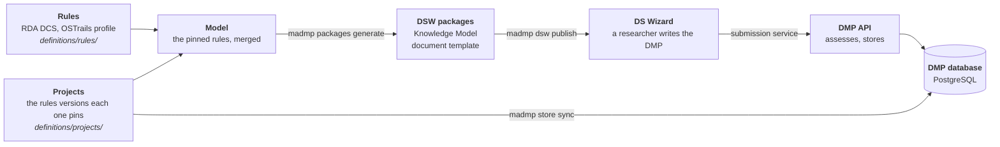
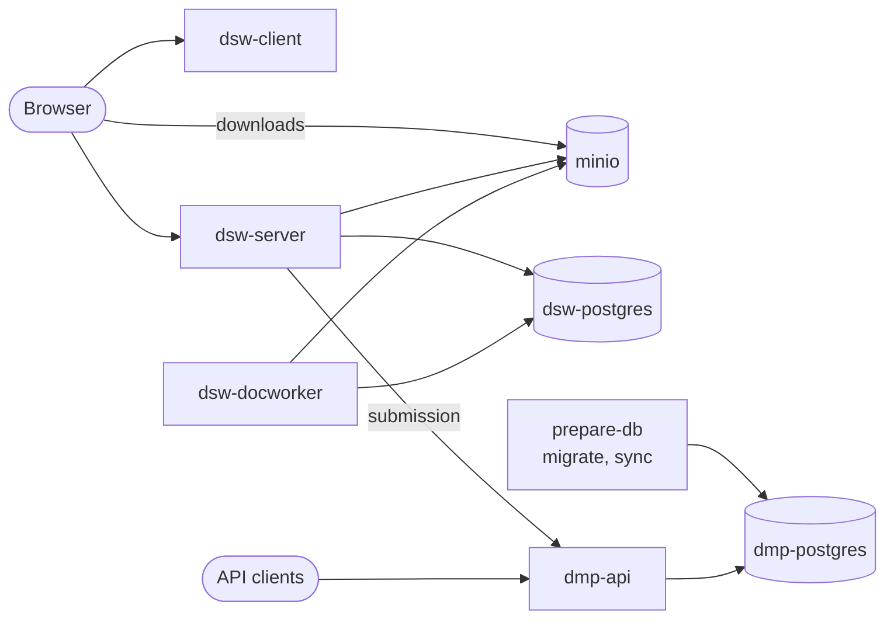

# madmp

[](https://github.com/pstcricq/ostrails-madmp/actions/workflows/ci.yml) [](https://www.python.org) [](https://docs.astral.sh/uv/) [](https://github.com/astral-sh/ruff) [](https://fastapi.tiangolo.com) [](https://www.postgresql.org) [](https://ds-wizard.org) [](deploy/docker) [](deploy/kubernetes) [](https://github.com/pstcricq/ostrails-madmp/pkgs/container/madmp) [](LICENSE)

Machine-actionable Data Management Plans (maDMPs) following the [RDA DMP Common Standard](https://github.com/RDA-DMP-Common/RDA-DMP-Common-Standard), extended by the [OSTrails Application Profile for maDMPs](https://docs.ostrails.eu/en/latest/commons/dmp/application-profile.html).

The rules of a maDMP and the projects that use them are versioned files. From them, `madmp` builds the Knowledge Model and the document template a [DS Wizard](https://ds-wizard.org) instance needs, deploys that instance, and stores every DMP it submits in a database of its own, through an API that assesses each DMP against the rules it names.

## How it works



1. **Rules.** A standard at one version is one JSON file: the base standard, the RDA DMP Common Standard, and the extensions that tighten it, such as the OSTrails profile. An extension may only tighten what the base defines.
2. **Projects.** A project at one version is one YAML file, which pins the rules it is built from. A published version never changes: a change is a new version.
3. **Packages.** The pinned rules merge into one model, from which `madmp` builds a DS Wizard Knowledge Model, the questions, and a document template that renders the answers as a maDMP JSON document.
4. **DS Wizard.** The packages are published to the instance, and its submission service sends a document to the DMP API.
5. **DMP API.** Each document is assessed against the rules its metadata names, then stored version by version: a project's template DMP first, then the production DMPs filled from it.

## What is here

| | |
|---|---|
| [`definitions/rules/`](definitions/rules) | the rules, one JSON file per standard per version, `<standard>/<version>.json`, and `rules.schema.json` |
| [`definitions/projects/`](definitions/projects) | the projects, one YAML file per project per version, `<id>/<version>.yaml`, and `project.schema.json` |
| [`src/madmp/`](src/madmp) | the `madmp` command: validation, assessment, DS Wizard packages, DMP database, DMP API, DS Wizard instance |
| [`Dockerfile`](Dockerfile) | the madmp image, which serves the DMP API and runs any `madmp` command |
| [`deploy/`](deploy) | the stack, the DMP API and DS Wizard with their servers, under Docker Compose (`deploy/docker/`) and on Kubernetes (`deploy/kubernetes/`) |
| [`.env.example`](.env.example) | every value the repository reads, with its local value; the values of one target alone are in its `deploy/<target>/.env.example` |
| [`tests/`](tests) | the unit and integration tests, and the DMPs they assess (`tests/fixtures/`) |

## Requirements

- Python 3.12 and [uv](https://docs.astral.sh/uv/) 0.12.5
- make
- Docker, for the integration tests, the image and the stack
- kubectl, envsubst (gettext) and [kubeconform](https://github.com/yannh/kubeconform), for the stack on Kubernetes, and [k3d](https://k3d.io) for its local cluster

## Quick start

```bash
make install
make validate-all
make packages-generate OUT=dsw-packages
```

`make install` sets up the locked environment in `.venv`, the `madmp` command and the git hooks. `make help` lists every target, `uv run madmp --help` every command.

To run the whole stack on this machine, DS Wizard and the DMP API with their servers, see [Deploy](#deploy).

## Commands

Each `madmp` command has a make target of the same name: `madmp store migrate` is `make store-migrate`. The targets that reach a server read their values from `ENV_FILE=<file>`, the lines of `.env.example` filled in, else from the environment; a missing value is named, and nothing is done.

### Definitions

| | |
|---|---|
| `make validate-all` | every rules file and project against its schema and its path, the rules each project pins merged, and no published version changed since `origin/main` (`BASE=<branch or commit>`) |
| `make assess-conformance DMP=<file or directory>` | each DMP against the rules its `metadata.rules` pins |
| `make packages-generate` | the Knowledge Model and the document template of every project version, built and checked; `OUT=<directory>` writes them, `PROJECT=definitions/projects/<id>` limits them to one project |

`make validate-rules`, `validate-projects`, `validate-models` and `validate-frozen` each run one step of `validate-all`.

### DMP database and API

| | |
|---|---|
| `make store-migrate` | the tables of the DMP database, up to date |
| `make store-sync` | the definitions copied into it |
| `make api-serve` | the DMP API on http://127.0.0.1:8081, until stopped |

The database and its account exist beforehand. One on this machine, at the local values of `.env.example`:

```bash
docker run -d --name dmp-db -p 127.0.0.1:5432:5432 -e POSTGRES_DB=dmp -e POSTGRES_USER=dmp_app -e POSTGRES_PASSWORD=<DMP_PASSWORD> postgres:17.5
```

Every request sends its token as `Authorization: Bearer <token>`:

| Route | Token | |
|---|---|---|
| `POST /templates` | `TEMPLATE_WRITE_TOKEN` | the next version of a project's template DMP |
| `POST /productions` | `DMP_WRITE_TOKEN` | a new production DMP, filled from a template version |
| `POST /productions/<key>/versions` | `DMP_WRITE_TOKEN` | its next version |
| `GET /dmps/<key>` | `DMP_READ_TOKEN` or `DMP_WRITE_TOKEN` | the latest version, with its assessment |
| `GET /dmps/<key>/versions` | the same | every version, without its content |
| `GET /dmps/<key>/versions/<number>` | the same | one version |

### DS Wizard instance

| | |
|---|---|
| `make dsw-admin` | the administrator `DSW_USER`, created on a new instance, its demo accounts deleted |
| `make dsw-publish` | the packages of every project version the instance does not hold yet, uploaded; one it holds with another content refused (`PROJECT=` limits them to one project) |
| `make dsw-submission` | the submission service `madmp`, which sends a submitted document to `SUBMISSION_URL` |
| `make dsw-sync` | the three above, in this order |

## Deploy

The stack runs the DMP API and DS Wizard, with the servers they need: a PostgreSQL for the DMPs, one for DS Wizard, and MinIO for DS Wizard's files. A target with servers of its own names them in its values instead, and the stack leaves them out.



The values of each target are every empty key of `.env.example` and of the target's own `.env.example`, filled in with the local value given beside each:

```bash
grep -E '^[A-Z][A-Z0-9_]*=$' .env.example > deploy/docker/.env
cat .env.example deploy/kubernetes/.env.example | grep -E '^[A-Z][A-Z0-9_]*=$' > deploy/kubernetes/.env
```

Without its file, a target reads the environment. With the stack's own MinIO, the browser finds it through `/etc/hosts`, once:

```bash
sudo sh -c 'echo "127.0.0.1 minio" >> /etc/hosts'
```

### Docker Compose

```bash
make docker-up
make dsw-sync ENV_FILE=deploy/docker/.env
```

DS Wizard opens at http://localhost:8080/wizard, the DMP API at http://localhost:8081.

| | |
|---|---|
| `make docker-check` | the values, and `docker-compose.yml` read with them |
| `make docker-up` | the check, the madmp image built, the stack started, every service healthy |
| `make docker-ps` | the containers and their health |
| `make docker-logs` | the logs, `s=<service>` for one, `n=<lines>` for the last ones |
| `make docker-down` | the stack stopped, its data kept |
| `make docker-reset` | the stack and its data deleted |

### Kubernetes

On a local [k3d](https://k3d.io) cluster:

```bash
make k3d-up
make k8s-up
make dsw-sync ENV_FILE=deploy/kubernetes/.env
```

The cluster's ingress listens on 127.0.0.1:8090: DS Wizard opens at http://localhost:8090/wizard, the DMP API at http://localhost:8090.

On any other cluster, its namespace `STACK_NAME` created there beforehand, the madmp image pulled from `MADMP_IMAGE`, found in its registry before anything is applied:

```bash
make k8s-deploy KUBE_CONTEXT=<context of kubectl>
make dsw-sync ENV_FILE=deploy/kubernetes/.env
```

| | |
|---|---|
| `make k8s-check` | the values, and the charts built with them and validated against the Kubernetes schemas |
| `make k8s-up` | the check, the madmp image built and imported into k3d, the stack applied, every Deployment ready |
| `make k8s-deploy` | the check, the madmp image found in its registry, the stack applied on `KUBE_CONTEXT`, every Deployment ready, one that fails rolled back |
| `make k8s-ps` | the pods, their state and the last events |
| `make k8s-logs` | the logs, `s=<service>` for one, `n=<lines>` for the last ones |
| `make k8s-down` | the stack stopped, its disks kept |
| `make k8s-reset` | the stack and its disks deleted |
| `make k3d-up`, `make k3d-down` | the local cluster created, deleted |

## Image

```bash
make image-build
```

The image `madmp:local` (`IMAGE=<name>:<tag>`) serves the DMP API on port 8081 by default, and runs any `madmp` command given instead:

```bash
docker run --rm madmp:local madmp --help
```

## CI and CD

The same pipeline runs on GitHub and on GitLab, one job per make target of the same name.

| | GitHub Actions | GitLab CI |
|---|---|---|
| Checks | lint, hooks, validation, packages, unit and integration tests | the same |
| Stacks | `docker-up` and `k8s-up` on the runner, then `dsw-sync` twice | `docker-up` and `k8s-up` on a dind daemon |
| Image | `ghcr.io/pstcricq/madmp:sha-<commit>`, amd64 and arm64 | the project's registry, same tags |
| Deploy | none | `k8s-deploy` by hand on the default branch, then `dsw-sync`, from the variables of the environment `development` |

`make ci` runs every check of the CI on this machine.

## Test

```bash
make test-all
make lint
```

`make test-unit` needs nothing but the repository. `make test-integration` starts a PostgreSQL with docker, and checks the DMP database, the API, the image, and the document each project version's template renders. `make lint` checks the Python and the shell scripts, `make format` fixes what it can, `make pre-commit` runs every hook on every file.

## Licence

Copyright 2026 Pierre St-Cricq dit Lompre (SOCIB), as part of the OSTrails project, funded by the European Union, grant agreement 101130187.

Apache 2.0, see [LICENSE](LICENSE). The DS Wizard stack derives from the DS Wizard team's deployment example, under the MIT License, see [NOTICE](NOTICE).
