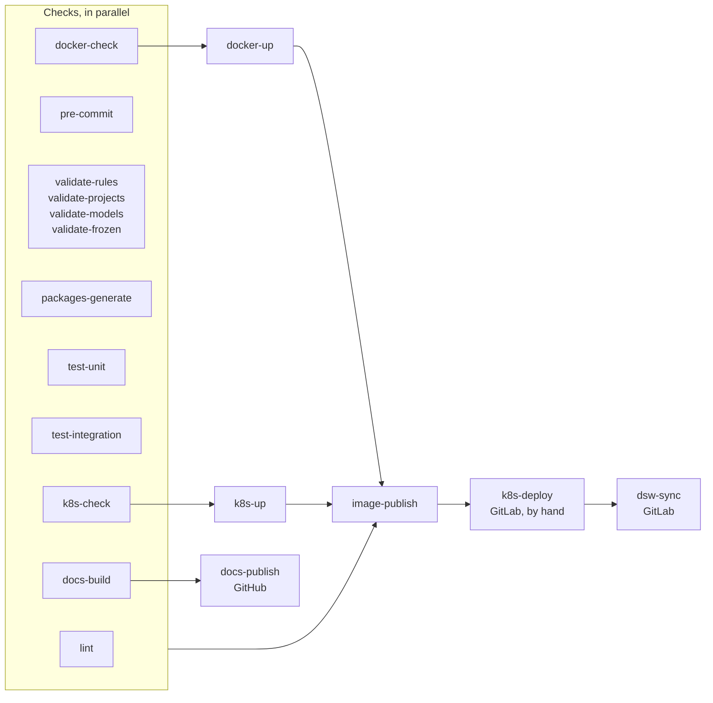
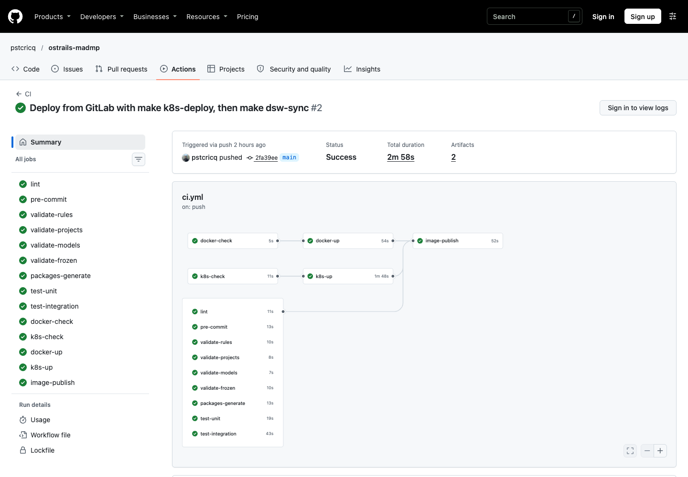

# CI and CD

The same pipeline runs on GitHub Actions and on GitLab CI, one job per make target of the same name, so a red job is reproduced on a laptop with the make target it names. GitHub checks and publishes; GitLab checks, publishes and deploys.





*A run on GitHub: the checks in parallel, the stacks after their checks, the image after everything.*

## The jobs

| Job | Checks or does | GitHub | GitLab |
|---|---|---|---|
| `lint` | ruff on the Python, shellcheck on every script | ✓ | ✓ |
| `pre-commit` | every hook on every file | ✓ | ✓ |
| `validate-rules`, `-projects`, `-models`, `-frozen` | the definitions; `frozen` against where the change left its base | ✓ | ✓ |
| `packages-generate` | every project version's two packages, built and checked | ✓ | ✓ |
| `test-unit` | the tests that need only the repository | ✓ | ✓ |
| `test-integration` | the tests against a PostgreSQL, the API and the image | ✓ | ✓ |
| `docker-check`, `k8s-check` | the values of a test stack, the compose file, the charts | ✓ | ✓ |
| `docker-up` | the test stack under Docker Compose | ✓, then `dsw-sync` twice | ✓, on a dind daemon |
| `k8s-up` | the test stack on a k3d cluster | ✓, then `dsw-sync` twice | ✓, on a dind daemon |
| `docs-build` | this site, `mkdocs build --strict` | ✓ | ✓ |
| `image-publish` | the madmp image, amd64 and arm64, after every other job | ghcr.io | the project's registry |
| `docs-publish` | this site on GitHub Pages, from `main` | ✓ | |
| `k8s-deploy` | the stack on the cluster of the environment `development` | | by hand, `main` |
| `dsw-sync` | DS Wizard's administrator, packages and submission service | | after `k8s-deploy` |

Running `dsw-sync` twice on the test stacks checks it changes nothing the second time: every package already published, the service unchanged.

## Shared rules

- **Locked versions.** Every job installs with `uv sync --locked`, which fails when `uv.lock` no longer matches `pyproject.toml`, and `UV_LOCKED` keeps every `uv run` of the make targets on the committed `uv.lock`.
- **Generated test values.** A test stack's secrets are generated with openssl at each run and masked in the logs; the addresses differ per target, set in the jobs of each.
- **Report, or act.** The checks run in parallel and each names its own culprit; what writes outside the repository (the image, the site, a deployment) waits for every check.
- **On failure, the logs.** A failed stack job prints `make docker-ps docker-logs n=50` or `make k8s-ps k8s-logs n=30`.

## When they run

| | GitHub | GitLab |
|---|---|---|
| pull or merge request | the checks | the checks |
| push to `main` | the checks, the image, the site | the checks, the image, the CD by hand |
| tag `vX.Y.Z` | the checks, the image tagged `vX.Y.Z` | the same |

`validate-frozen` compares a pull request with where it left its base, a push to `main` with the commit it moved the branch from, and anything else with the default branch.

## The CD

On GitLab, after the checks of a push to `main`:

1. **`k8s-deploy`**, started by hand: `make k8s-deploy KUBE_CONTEXT=gitlab-deploy`, with `MADMP_TAG=sha-<commit>`, the image the GitHub CI published for the same commit. While it is not there, the job stops before applying anything; run it again once GitHub has published it.
2. **`dsw-sync`**, right after: the administrator, the packages of this commit's definitions, the submission service.

Both belong to the GitLab environment `development` and share its resource group, so two deployments never overlap. Their values are the protected variables of that environment, one per key of the two examples, the secrets masked, plus `KUBECONFIG`, a File variable holding the kubeconfig of a deploy account with the `edit` role on the namespace. The environment's URL opens DS Wizard from GitLab's Environments page.

Because the image, the packages and the definitions copied into the database all come from one commit, what DS Wizard offers, what the database judges and what the API runs never disagree.

## Running the CI on a laptop

```bash
make ci
```

`lint`, `pre-commit`, `validate-all`, `packages-generate`, `test-all`, `docker-check` `k8s-check` and `docs-build`, in this order: everything the CI checks without starting a stack.
