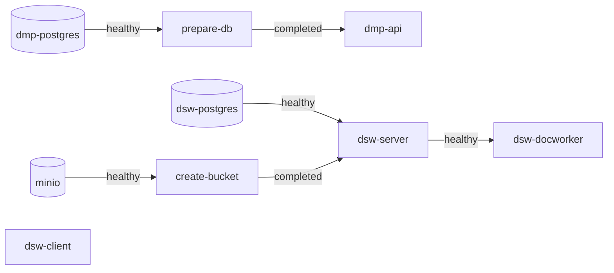

# Docker Compose

The stack under Docker Compose, for a laptop or a single docker host: `deploy/docker/`.

```bash
make docker-up
make dsw-sync ENV_FILE=deploy/docker/.env
```

| | |
|---|---|
| DS Wizard | <http://localhost:8080/wizard> |
| DS Wizard API | <http://localhost:3000/wizard-api> |
| DMP API | <http://localhost:8081> |
| MinIO | <http://minio:9000>, with `127.0.0.1 minio` in `/etc/hosts` |

Every port is published on `127.0.0.1` only. MinIO is reached by the name `minio` from the browser as from the containers, because DS Wizard hands the browser download links with the address it uses itself.

## The files

| File | |
|---|---|
| `docker-compose.yml` | the services, every variable written `${NAME?}`: compose stops when one is set nowhere |
| `scripts/check.sh` | the values, the servers the stack runs, then `docker compose config` with them |
| `scripts/prepare.sh` | the check, the madmp image built from this checkout, then `deploy.sh` |
| `scripts/deploy.sh` | `docker compose up -d --wait` on any docker host `DOCKER_HOST` names, its images there or pulled, never built |

## How it starts



`up --wait` returns once every health check passes, and fails when a service exits with an error: the services that wait for it are not started. A container whose image or configuration changed is recreated, the others are left running.

The three servers are compose **profiles**, `dmp-database`, `dsw-database` and `storage`, activated through `COMPOSE_PROFILES` from what the values name. A service waits for one only when it runs (`required: false`).

At the end, `deploy.sh` tells whether DS Wizard's demo accounts still log in: until `make dsw-admin` has run, they open a fresh instance completely.

## Day to day

| | |
|---|---|
| `make docker-check` | the values and the compose file, nothing started |
| `make docker-ps` | the containers and their health |
| `make docker-logs` | the logs, `s=<service>` for one, `n=<lines>` for the last ones instead of following |
| `make docker-down` | the stack stopped, its volumes kept |
| `make docker-reset` | the stack and its volumes deleted, after a confirmation |

The data lives in three named volumes, `dmp-postgres-data`, `dsw-postgres-data` and `minio-data`, prefixed by `STACK_NAME`: another name is another stack with its own data.

## On another docker host

`deploy.sh` builds nothing. On a remote docker host with the values in its environment and the image in a registry:

```bash
export DOCKER_HOST=ssh://deploy@docker-host
export MADMP_IMAGE=ghcr.io/pstcricq/madmp MADMP_TAG=sha-<commit>
bash deploy/docker/scripts/deploy.sh
```

Ports are published on `127.0.0.1` of that host, for a reverse proxy in front of it.
