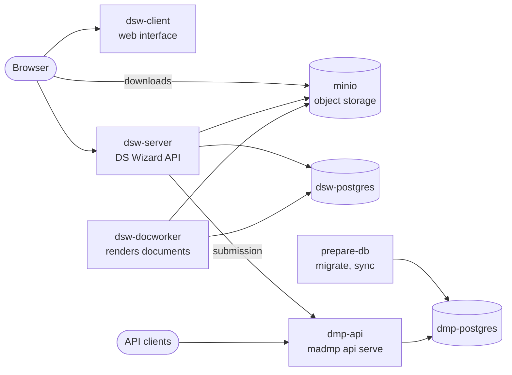

# Deployment

The stack runs DS Wizard and the DMP API, with the servers they need. It is described twice, once for Docker Compose and once for Kubernetes, with the same services, the same values and the same checks.

## The services



| Service | Image | Role |
|---|---|---|
| `dmp-postgres` | `postgres:17.5` | the DMP database, when the stack runs it |
| `prepare-db` | madmp | `madmp store migrate` then `madmp store sync`, once, before the API |
| `dmp-api` | madmp | the DMP API, port 8081 |
| `dsw-postgres` | `postgres:17.5` | DS Wizard's database, when the stack runs it |
| `minio` | `pgsty/minio` | DS Wizard's files, when the stack runs it |
| `create-bucket` | `pgsty/mc` | creates DS Wizard's bucket on the stack's MinIO, or checks it exists on the target's |
| `dsw-server` | `datastewardshipwizard/wizard-server:4.31.3` | DS Wizard's API, port 3000 |
| `dsw-docworker` | `datastewardshipwizard/document-worker:4.31.0` | renders documents into the bucket |
| `dsw-client` | `datastewardshipwizard/wizard-client:4.31.0` | the web interface, port 8080 |

## A target runs what it lacks

The three servers are optional. The stack runs one only when the values name it by its service; any other address is a server of the target, and the stack leaves it out.

| Server | The stack runs it when | Otherwise |
|---|---|---|
| DMP database | `DMP_HOST=dmp-postgres` | a PostgreSQL of the target |
| DS Wizard database | `DSW_DB_HOST=dsw-postgres` | a PostgreSQL of the target |
| Object storage | the host of `S3_URL` is `minio` | an S3 server of the target, Ceph for example |

On a laptop the stack runs all three; on a cluster with a managed object storage, it runs the two databases and points DS Wizard at the bucket the target provides.

## Two targets, one stack

| | Docker Compose | Kubernetes |
|---|---|---|
| Described in | `deploy/docker/docker-compose.yml` | `deploy/kubernetes/charts/`, kustomize |
| Values | `deploy/docker/.env`, else the environment | `deploy/kubernetes/.env`, else the environment |
| Optional servers | compose profiles | kustomize components |
| Start order | `depends_on`, health checks | init containers, a Job |
| Reached at | ports on `127.0.0.1` | an Ingress, by host and path |
| Data | named volumes | PersistentVolumeClaims |
| Check | `make docker-check` | `make k8s-check` |
| Start on this machine | `make docker-up` | `make k8s-up`, on k3d |
| Deploy elsewhere | `deploy/docker/scripts/deploy.sh` on a docker host | `make k8s-deploy KUBE_CONTEXT=<context>` |

The scripts follow one split: **check** is what the CI runs, **prepare** readies this machine (build the image, import it into k3d) then deploys, **deploy** only deploys, which is what a CD job calls.

## The madmp image

```bash
make image-build                     # madmp:local
docker run --rm madmp:local madmp --help
```

The `Dockerfile` installs the locked environment and the package in a build stage, then copies them, with the definitions, the licence and the notice, onto `python:3.12.16-slim-trixie`, its Python patch and its Debian release named, as a non-root user working in `/app`. Its default command serves the DMP API on `0.0.0.0:8081`.

| Where | Image |
|---|---|
| this machine | `madmp:local`, built by `docker-up` and `k8s-up` |
| CI, every push to `main` | `ghcr.io/pstcricq/madmp:sha-<commit>`, amd64 and arm64, and the GitLab project's registry |
| a version tag `vX.Y.Z` | the same, also tagged `vX.Y.Z` |

`MADMP_IMAGE` and `MADMP_TAG` choose the image the stack runs. The image carries the definitions of its commit, so `prepare-db` fills the database with exactly those.

## Next

- [Values](values.md): what each target reads, and how it is checked.
- [Docker Compose](docker.md) and [Kubernetes](kubernetes.md): each target in detail.
- [CI and CD](ci-cd.md): the pipelines on GitHub and GitLab.
- [Operations](operations.md): logs, updates, resets, troubleshooting.
