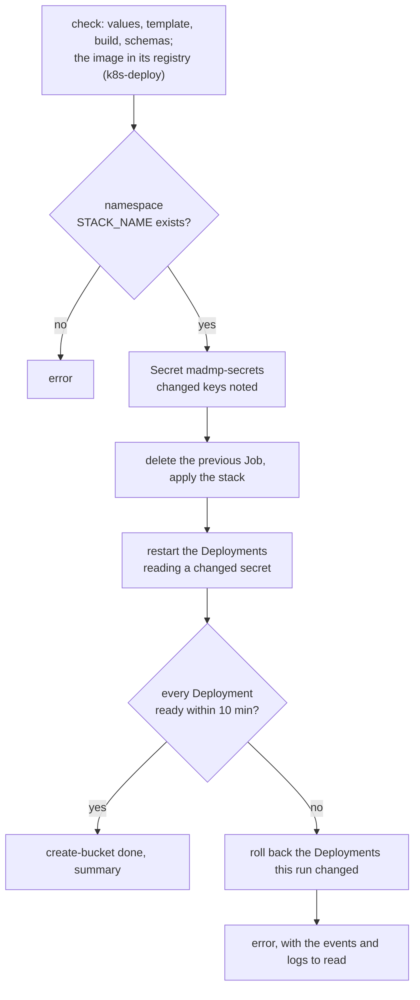

# Kubernetes

The same stack on Kubernetes, for a local [k3d](https://k3d.io) cluster or any cluster: `deploy/kubernetes/`.

=== "Local cluster, k3d"

    ```bash
    make k3d-up
    make k8s-up
    make dsw-sync ENV_FILE=deploy/kubernetes/.env
    ```

    k3d runs Kubernetes 1.30.10 in docker containers, with Traefik as its ingress on `127.0.0.1:8090`: DS Wizard at <http://localhost:8090/wizard>, the DMP API at <http://localhost:8090>. `k8s-up` builds the madmp image and imports it into the cluster, creates the namespace, then deploys.

=== "Any cluster"

    ```bash
    make k8s-deploy KUBE_CONTEXT=<context of kubectl>
    make dsw-sync ENV_FILE=deploy/kubernetes/.env
    ```

    The namespace `STACK_NAME` exists already, the account of the context may create Deployments, Services, Ingresses, Secrets, ConfigMaps, PersistentVolumeClaims and Jobs in it (the `edit` role is enough), and the cluster pulls the madmp image from `MADMP_IMAGE`, which must be there: `k8s-deploy` reads it from its registry with docker's client, before anything is applied. Nothing is built, and the context is always named, never the current one.

## The charts

Plain manifests assembled by kustomize, no Helm.

```text
deploy/kubernetes/
├── k3d.yaml                    the local cluster
├── charts/
│   ├── kustomization.yaml      base + components + template, the part-of label on everything
│   ├── base/                   the services, without any value
│   │   ├── dmp-api.yaml        Deployment (wait-for-dmp-db, prepare-db, dmp-api), Service, Ingress
│   │   ├── create-bucket.yaml  Job
│   │   ├── dsw-server.yaml     Deployment, Service, Ingress
│   │   ├── dsw-docworker.yaml  Deployment
│   │   └── dsw-client.yaml     Deployment, Service, Ingress
│   ├── components/             the servers the stack may run itself
│   │   ├── dmp-database/       PVC, Deployment, Service
│   │   ├── dsw-database/       PVC, Deployment, Service
│   │   └── storage/            MinIO: PVC, Deployment, Service, Ingress
│   └── templates/              the holes ${KEY}, filled in a copy at each check
└── scripts/
    ├── check.sh                values, template, build, schemas
    ├── prepare.sh              k3d only: image, import, namespace, then deploy.sh
    └── deploy.sh               any cluster: Secret, apply, wait, roll back
```

`base/` holds no value at all: no URL, no password, no namespace, no image tag, `placeholder` where one goes. The pods read their values from two objects, by the keys of the examples: the ConfigMap `madmp-config` for the variables, the Secret `madmp-secrets` for the secrets. The ConfigMap's name carries a hash of its content, so a changed value restarts the pods that read it.

## The check

`make k8s-check`, what the CI runs, touches no cluster:

1. **the values**, then the servers the stack runs itself;
2. **the template**, filled in a temporary copy of the charts: the components of the servers the stack does not run left out, every hole filled, none a secret, the ingress hosts and MinIO's port read from the URLs;
3. **the build** by kustomize, no `placeholder` left;
4. **the schemas**: each object validated by kubeconform `-strict` against Kubernetes 1.30.10, the version `k3d.yaml` runs.

```text
Checks
  values                        36 keys: 7 fixed, 13 secrets and 16 variables from deploy/kubernetes/.env
  servers                       run by the stack: dmp-database dsw-database storage
  template                      25 holes filled
  build                         22 objects, no placeholder left
  schema                        22 objects valid for Kubernetes 1.30.10 (6 schemas)
```

*With every server run by the stack, 22 objects; on a cluster that provides the object storage, 18.*

## The deployment

`deploy.sh <context>`, behind `make k8s-deploy` and `make k8s-up`:



- **The Secret** is written from the environment to kubectl's standard input, never to a file. A changed password of a PostgreSQL the stack runs is warned about: the server keeps the one it was created with.
- **The wait** tries `kubectl rollout status` up to three times, since an API server may cut a watch early, and a Deployment that is not ready says why.
- **A failed Deployment** this run changed goes back to its previous version (`rollout undo`); one it did not change is waited for again.

## Ingress

Each service reached from outside has an Ingress on the host of its URL, with the class `INGRESS_CLASS`:

| Ingress | Host from | Path |
|---|---|---|
| `dsw-client` | `DSW_CLIENT_URL` | `/wizard` |
| `dsw-server` | `DSW_API_URL` | `/wizard-api` |
| `dmp-api` | `DMP_API_URL` | `/`, every path the longer ones leave |
| `minio` | `S3_URL` | `/`, when the stack runs MinIO |

One host can carry all of them. `dmp-api`, `dsw-server` and `dsw-client` keep answering five seconds after they are told to stop, while the ingress moves its requests to the new pod.

## Day to day

| | |
|---|---|
| `make k8s-ps` | the pods, their state and the last events |
| `make k8s-logs` | the logs, `s=<service>` for one, `n=<lines>` for the last ones of every pod |
| `make k8s-down` | every Deployment scaled to zero, disks, Secret and ConfigMap kept |
| `make k8s-reset` | the namespace and its disks deleted, after a confirmation |
| `make k3d-down` | the local cluster deleted |

These targets act on the k3d cluster. On another cluster, use kubectl with its context and the label every object carries: `-l app.kubernetes.io/part-of=madmp`.
