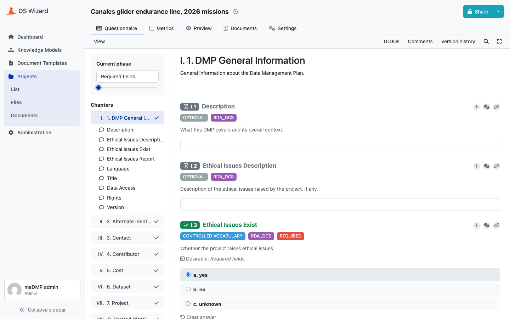
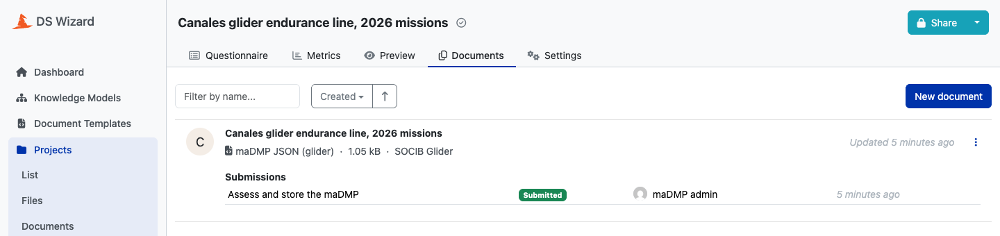

# Getting started

From a fresh clone to a DS Wizard instance that stores what it submits, in four steps. Every step is a make target; `make help` lists them all and `uv run madmp --help` every command behind them.

## Requirements

| Tool | For |
|---|---|
| Python 3.12 and [uv](https://docs.astral.sh/uv/) 0.12.5 | the `madmp` command and its environment |
| make | every step below |
| Docker | the integration tests, the image and the stack |
| kubectl, envsubst (gettext), [kubeconform](https://github.com/yannh/kubeconform) | the stack on Kubernetes |
| [k3d](https://k3d.io) | a local Kubernetes cluster |

## 1. Install

```bash
git clone https://github.com/pstcricq/ostrails-madmp.git
cd ostrails-madmp
make install
```

`make install` creates `.venv` from the committed lockfile, with the `madmp` command, and installs the git hooks: the formatting, lint and definition checks run on each commit, the unit tests on each push.

## 2. Check the definitions

```bash
make validate-all
```

```text
ok   definitions/rules/ostrails/1.0.0.json : ostrails 1.0.0
ok   definitions/rules/rda_dcs/1.0.0.json : rda_dcs 1.0.0

rules: 2 files valid.

ok   definitions/projects/glider/1.0.0.yaml : glider 1.0.0

projects: 1 file valid.

ok   definitions/projects/glider/1.0.0.yaml : rda_dcs + ostrails, 163 fields

models: 1 project version resolved and merged.

frozen: no published version changed since 276a629.
```

Four steps, in this order, stopping at the first that fails: every rules file against its schema, its path and its coherence; every project the same way; every project's pins resolved and their rules merged; and no published version changed since the branch left `origin/main`. See [Rules](guide/rules.md) and [Projects](guide/projects.md).

## 3. Build the packages

```bash
make packages-generate OUT=dsw-packages
```

```text
ok   glider 1.0.0 : KM and document template, 163 fields, glider_1.0.0_km.km and glider_1.0.0_template.json

packages: 1 project version built, written into dsw-packages.
```

`dsw-packages/` now holds the two files DS Wizard imports for each project version: `glider_1.0.0_km.km`, the questionnaire, and `glider_1.0.0_template.json`, the document template. Both are built and checked in memory first: a Knowledge Model that emits an entity twice, or a template body that is not Jinja, fails here. See [Knowledge model](guide/knowledge-model.md) and [Document template](guide/document-template.md).

To check a DMP against the rules it pins, without any server:

```bash
make assess-conformance DMP=tests/fixtures
```

```text
ok   tests/fixtures/rda_dcs-ostrails.json : rda_dcs + ostrails, 145 checks: 0 fail, 0 warning, 37 missing, 108 pass
ok   tests/fixtures/rda_dcs.json : rda_dcs, 117 checks: 0 fail, 0 warning, 30 missing, 87 pass

2 DMPs assessed, none failing.
```

## 4. Run the stack

The stack is DS Wizard and the DMP API with the servers they need. Under Docker Compose:

```bash
grep -E '^[A-Z][A-Z0-9_]*=$' .env.example > deploy/docker/.env
```

Fill in each key of `deploy/docker/.env` with the local value `.env.example` gives beside it (secrets with `openssl rand -hex 24`), then let the browser find the stack's own MinIO, once:

```bash
sudo sh -c 'echo "127.0.0.1 minio" >> /etc/hosts'
```

```bash
make docker-up
make dsw-sync ENV_FILE=deploy/docker/.env
```

`docker-up` checks the values, builds the madmp image, starts every service and waits until each is healthy. `dsw-sync` creates DS Wizard's administrator `DSW_USER` and deletes its demo accounts, publishes the packages, and points DS Wizard's submission service at the DMP API.

| | |
|---|---|
| DS Wizard | <http://localhost:8080/wizard>, as `DSW_USER` |
| DMP API | <http://localhost:8081>, `/health` without a token |

Open DS Wizard, create a project on the **SOCIB Glider** Knowledge Model, answer the required questions, create a document with the **SOCIB Glider** template, and submit it through the **madmp** service.



*The generated questionnaire: nine chapters on the left, each question tagged with its status and the standard it comes from, the Required fields phase at the top.*



*The document rendered in the maDMP JSON format, and its submission through the madmp service.*

Then read it back:

```bash
curl -H "Authorization: Bearer $DMP_READ_TOKEN" http://localhost:8081/dmps/socib-glider-template
```

The same on a local Kubernetes cluster is `make k3d-up` then `make k8s-up`; see [Kubernetes](deployment/kubernetes.md).

## What next

- [Architecture](guide/architecture.md): the parts and how a DMP travels between them.
- [Development](development.md): the tests, the CI, adding a rules version or a project version.
- [Deployment](deployment/index.md): the values of a target, and the CD.
