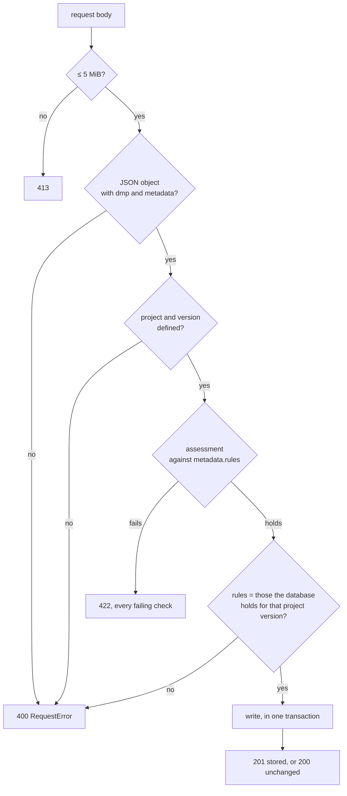

# DMP API

The only way into the [DMP database](database.md). Every write is assessed first and answers with its assessment; every DMP is read back with its history. A FastAPI application, served by `madmp api serve` on port 8081, from the madmp image in the stack.

```bash
make api-serve ENV_FILE=<file>    # http://127.0.0.1:8081, until stopped
```

## Routes

| Method and path | Token | Body | Does |
|---|---|---|---|
| `GET /health` | none | | 200 once the values are read and the database is up to date |
| `POST /templates` | `TEMPLATE_WRITE_TOKEN` | a maDMP: `dmp` and `metadata` | the next version of the project's template DMP |
| `POST /productions` | `DMP_WRITE_TOKEN` | `from_template_version`, `dmp`, `metadata` | a new production DMP, filled from that template version |
| `POST /productions/<key>/versions` | `DMP_WRITE_TOKEN` | `based_on`, `from_template_version`, `dmp`, `metadata` | its next version, refused unless `based_on` is the latest |
| `GET /dmps/<key>` | `DMP_READ_TOKEN` or `DMP_WRITE_TOKEN` | | the latest version |
| `GET /dmps/<key>/versions` | the same | | every version, without its content |
| `GET /dmps/<key>/versions/<number>` | the same | | one version |

Every token is sent as `Authorization: Bearer <token>` and compared in constant time. The three tokens are separate on purpose: DS Wizard's submission service holds the **template** token, which writes a template DMP and nothing else; the **write** token belongs to whoever manages the production DMPs; the **read** token to whoever only reads.

## What a write goes through



The checks that need no database come first, so a document that does not hold up is refused even when the database is down. The write itself runs in one transaction: it lands whole or not at all.

## Answers

| Status | When |
|---|---|
| **201** | a new version was written |
| **200** | the latest version already holds this content: nothing added |
| **400** | the request cannot be taken: not a DMP with its metadata, an unknown project or project version, rules other than the ones that project version pins |
| **401** | no token, or not the right one |
| **404** | no such DMP, or not one this write can take |
| **409** | `based_on` is no longer the latest version: somebody wrote in between |
| **413** | a body larger than 5 MiB |
| **422** | the document does not hold up, or the database refuses the write |
| **503** | the database cannot be reached |

A refusal is plain text, the message as it is, every failing check on its own line, at most twenty spelled out before the rest is counted:

```text
Assessment failed against rda_dcs 1.0.0, ostrails 1.0.0.

2 failure(s) to fix:
  'dmp.language': 'english' is not an ISO 639-3 language code (3 lowercase letters).
  Required field 'dmp.title' (cardinality 1) is missing.

104 checks passed, 37 optional fields left empty.
```

*What DS Wizard shows a researcher whose submission is refused.*

## Writing a template DMP

DS Wizard's submission service does this; by hand:

```bash
curl -X POST http://localhost:8081/templates \
  -H "Authorization: Bearer $TEMPLATE_WRITE_TOKEN" \
  -H "Content-Type: application/json" \
  --data @glider.json
```

```json
{
  "project": "glider",
  "key": "socib-glider-template",
  "version": 1,
  "action": "created",
  "message": "Stored as socib-glider-template version 1. 108 checks passed, 37 optional fields left empty.",
  "assessment": { "verdict": "pass", "summary": { "total": 145, "fail": 0, "warning": 0, "missing": 37, "pass": 108 }, "…": "…" }
}
```

`action` is `created` for a DMP's first version, `updated` for a next one, `unchanged` when nothing was added. The full [assessment envelope](assessment.md#the-envelope) is returned and stored.

## Reading a DMP

```bash
curl -H "Authorization: Bearer $DMP_READ_TOKEN" http://localhost:8081/dmps/socib-glider-template
```

```json
{
  "key": "socib-glider-template",
  "version": 1,
  "created_at": "2026-11-10T10:37:17.184140+00:00",
  "source": "templates",
  "project_version": "1.0.0",
  "from_template_version": null,
  "dmp": { "title": "…", "dmp_id": { "identifier": "socib-glider-template", "type": "other" }, "…": "…" },
  "metadata": { "project": "glider", "project_version": "1.0.0", "rules": [{ "rda_dcs": "1.0.0" }, { "ostrails": "1.0.0" }] },
  "assessment": { "verdict": "pass", "…": "…" }
}
```

`GET /dmps/<key>/versions` lists every version with its number, date, source, project version, template version and verdict, without the documents.

## Starting

`madmp api serve` reads its values once, before serving anything, and refuses to start, naming what is missing, when one of them is unset or when the database lacks a migration of this version:

| Value | |
|---|---|
| `TEMPLATE_WRITE_TOKEN`, `DMP_READ_TOKEN`, `DMP_WRITE_TOKEN` | the three tokens |
| `DMP_HOST`, `DMP_PORT`, `DMP_DB`, `DMP_USER`, `DMP_PASSWORD` | the DMP database |

It logs one line per write: the project or the DMP, and what happened, never the document. `/health` answers without touching the database, so a slow database never restarts the API.
