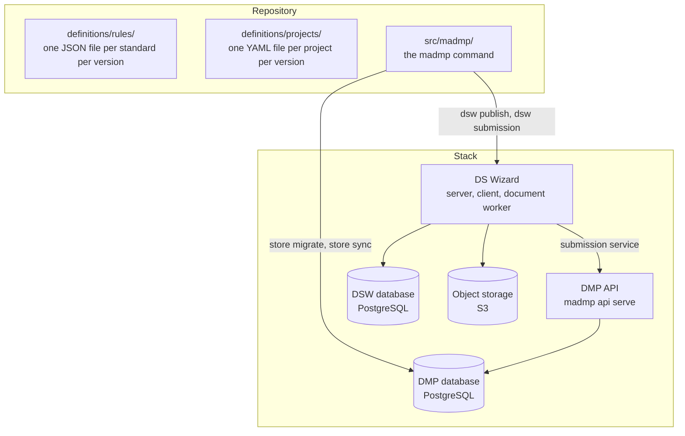
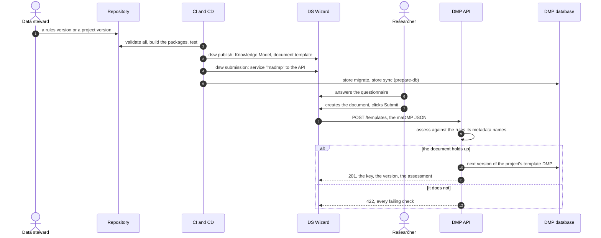
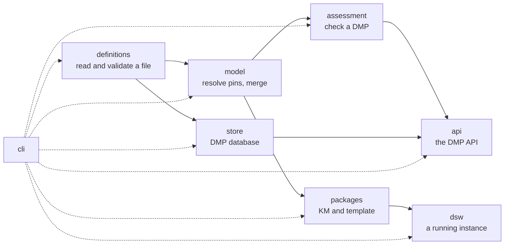

# Architecture

One repository holds the data, the code that reads it, and the stack that runs it. This page is the map: what each part is, how a DMP travels between them, and where each part lives in the code.

## The parts

| Part | What it is | Where |
|---|---|---|
| **Rules** | the maDMP standards as data: the RDA DMP Common Standard and the profiles that extend it | `definitions/rules/` |
| **Projects** | one file per project version: its identity and the rules versions it pins | `definitions/projects/` |
| **madmp** | one Python command, a group of subcommands per area | `src/madmp/` |
| **DS Wizard** | the DMP platform a researcher writes in, version 4.31 | `deploy/` |
| **DMP API** | the only way into the DMP database: assesses every write, serves every read | `src/madmp/api/` |
| **DMP database** | every DMP version, with its assessment and the definitions it was judged by | `src/madmp/store/` |

## From a rule to a stored DMP

The researcher never sees the rules, the steward never edits DS Wizard by hand, and nothing reaches the database without its assessment.

## The madmp command

Six groups, each with its make target of the same name.

| Group | Commands | Reads | Writes |
|---|---|---|---|
| `validate` | `rules`, `projects`, `models`, `frozen`, `all` | the repository, git | nothing |
| `assess` | `conformance` | DMP files | nothing |
| `packages` | `generate` | the repository | the two packages, with `--out` |
| `store` | `migrate`, `sync` | the repository | the DMP database |
| `api` | `serve` | the environment | serves the DMP API |
| `dsw` | `admin`, `publish`, `submission` | the repository | a DS Wizard instance |

Each command reads its values from the environment, names every one that is missing before doing anything, and exits 0 when every item passed, 1 otherwise. Make adds `ENV_FILE=<file>` to read them from a file instead.

## Inside the package

| Package | Knows | Depends on |
|---|---|---|
| `definitions` | where a definition lives, how it is read and checked, what changed since a git revision | jsonschema, pyyaml |
| `model` | which rules files a pin names, and how they merge | `definitions` |
| `assessment` | whether a DMP holds up against a model | `model` |
| `packages` | what a field becomes in DS Wizard, the two packages | `model`, jinja2 |
| `store` | the DMP database: its schema, the definitions in it, the DMPs | psycopg |
| `api` | the routes, the tokens, what each write checks | `assessment`, `store`, FastAPI |
| `dsw` | a running instance: its administrator, its packages, its submission service | `packages`, the standard library |
| `cli` | the command line, one module per group | everything above |

The rule that keeps the layout stable is what a module **knows**, not who calls it: `dsw` speaks HTTP to DS Wizard and knows nothing of the database, `store` knows SQL and nothing of DS Wizard. The base install needs only jsonschema, pyyaml and jinja2; the `store` extra adds psycopg, the `api` extra FastAPI and uvicorn on top of it.

## The image

One image, `madmp`, built from the repository's `Dockerfile`, runs both halves of the stack's own code:

- `madmp store migrate` and `madmp store sync`, once before the API starts (`prepare-db`)
- `madmp api serve`, its default command

It carries the definitions it was built with, so the database holds exactly the rules and projects of the image's commit. See [The image](../deployment/index.md#the-madmp-image).
