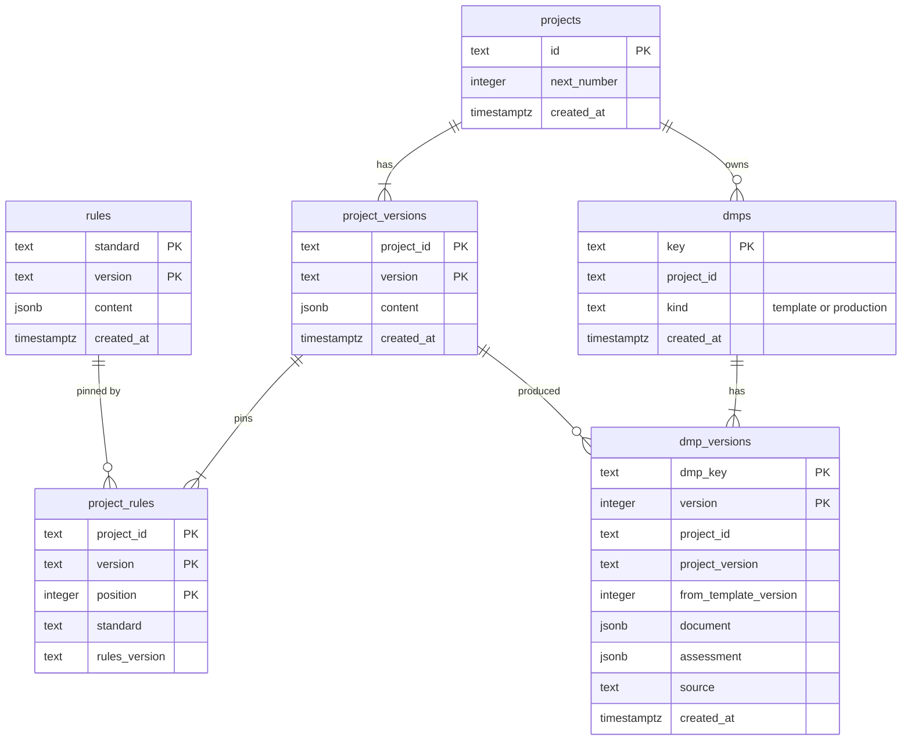
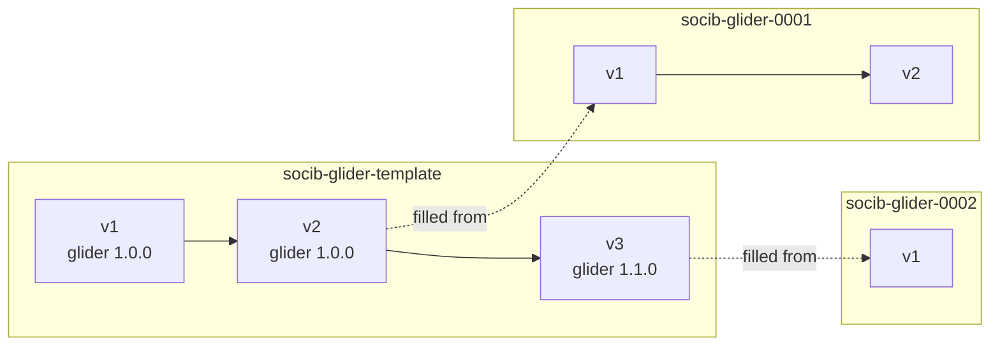

# DMP database

A PostgreSQL database holds every DMP version, beside a frozen copy of the definitions it was judged by. Only the [DMP API](api.md) writes DMPs into it; `madmp store` brings its schema and its definitions up to date.

```bash
make store-migrate ENV_FILE=<file>    # the tables, up to date
make store-sync ENV_FILE=<file>       # the rules and projects, copied in
```

The database and the account that owns it exist beforehand; under Docker Compose and Kubernetes, the stack's own PostgreSQL creates them at its first start. The values are `DMP_HOST`, `DMP_PORT`, `DMP_DB`, `DMP_USER` and `DMP_PASSWORD`.

## The tables



| Table | One row per | Notes |
|---|---|---|
| `rules` | rules file at one version | its content as `jsonb` |
| `projects` | project | `next_number`: the number its next production DMP takes |
| `project_versions` | project at one version | its content as `jsonb` |
| `project_rules` | pin of a project version | in the order written, referencing the rules row |
| `dmps` | DMP | its key, its project, `template` or `production`; one template per project |
| `dmp_versions` | version of a DMP | the document, its assessment, the project version and template version it came from, what wrote it |
| `schema_versions` | migration applied | written by `madmp store migrate` |

**Nothing is ever overwritten.** A trigger refuses any `UPDATE` on `rules`, `project_versions`, `project_rules` and `dmp_versions`: a change is a new row, a new version. A version's metadata (the project, its version, its rules) is not stored with the document: it is read back from the definitions the database holds, so it cannot disagree with them.

## DMPs and their keys



- **The template DMP**, `<organization>-<project>-template`: what DS Wizard submits. Each submission whose content differs from the latest version adds the next one; the same content adds nothing.
- **A production DMP**, `<organization>-<project>-<number>`: one deployment's plan, filled from a version of the template, then versioned on its own. Its number is the project's next, at least four digits, never given twice.

A production version names the version it is based on, and is refused when that is no longer the latest: two people editing the same plan never silently overwrite each other.

## Migrations

The schema is the SQL files `src/madmp/store/migrations/NNN_<name>.sql`, applied in order of their number:

| Migration | Adds |
|---|---|
| `001_init.sql` | the definitions: `rules`, `projects`, `project_versions`, `project_rules`, and the trigger that refuses updates |
| `002_dmps.sql` | the DMPs: `dmps`, `dmp_versions`, `projects.next_number` |

`madmp store migrate` applies what the database has not had, in one transaction, behind an advisory lock: two processes starting at once apply the migrations once, the second finding nothing left to do. A database holding a migration this version does not have was migrated by a newer version, and is refused. The API refuses to start on a database that lacks one of its migrations.

## Sync

`madmp store sync` copies every definition of the repository the database does not hold yet, rules first, then each project version with its pins. A version already there is compared by content, `jsonb` equality, so the order of the keys and the layout of the file do not count. A version whose content differs is **refused**, every one named at once, and nothing is written: a published version is frozen in the database as it is in git.

A file removed from git stays in the database: a DMP may still point at it.

## Where it runs

Under Docker Compose and Kubernetes, `prepare-db` runs `madmp store migrate` then `madmp store sync` from the madmp image, at every start, before the API: the database always holds the definitions of the image's commit. See [Deployment](../deployment/index.md).
