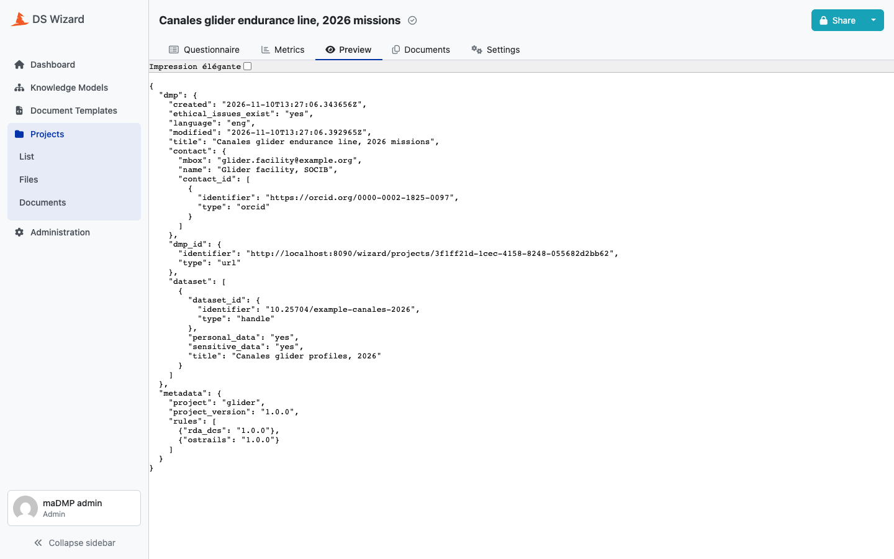

# Document template

`madmp.packages.template` walks the **same** merged model as the Knowledge Model generator and emits a DS Wizard document template: Jinja that turns a project's replies into a maDMP JSON document.

```python
TEMPLATE_METAMODEL_VERSION = "18.0"
```

A separate number from the Knowledge Model's metamodel version, 20. Both describe the DS Wizard instance, not the project, and both are checked when DS Wizard is upgraded.

## The output

One JSON document with two top-level keys:

```json
{
  "dmp": { "title": "…", "contact": { "…": "…" }, "dataset": [ "…" ] },
  "metadata": {
    "project": "glider",
    "project_version": "1.0.0",
    "rules": [{ "rda_dcs": "1.0.0" }, { "ostrails": "1.0.0" }]
  }
}
```



*DS Wizard's preview of the document: the answers under `dmp`, the computed `created`, `modified` and `dmp_id`, and the `metadata` block.*

`metadata` names what the document was built from, written when the template is generated, the same whatever the replies. The [DMP API](api.md) reads it to know which rules to judge the plan against and which project version it belongs to, then stores the `dmp` object and rebuilds the metadata from the definitions it holds.

## Never a UUID by hand

Every question UUID the template references comes from `madmp.packages.uuids`, applied to the model the Knowledge Model generator walks.

!!! danger "Two rules, and they are not style"

    Never write a UUID literal in the template generator, and never copy one out of a published Knowledge Model. Both work the day they are done and both break silently the day a field moves.

The agreement is tested without a fixture: both packages are generated, and every path the template reads, collected by rendering it, is confronted with where the Knowledge Model hangs that question. Recording our own output as the expected one would be recording ourselves.

## Literal JSON, and three consequences

The template emits JSON as **literal text**. Nothing stands between a reply and the file.

**Every key carries its comma in front.** Each optional key sits in its own conditional block, an object's body is captured, and the comma of whichever key ended up first is dropped. No key therefore has to be unconditional: a standard may declare an object whose children are all optional, and closing it is the generator's problem, not the rules'.

**Everything that renders text is escaped, through one macro.**

| Macro | Does |
|---|---|
| `sv(path)` | the raw string value of a reply |
| `av(path, default)` | the raw answer label of an options reply |
| `js(text)` | escapes a string for the inside of a JSON string |
| `jv(path)` | `js` applied to a reply, the one used for output |

`sv` and `av` are raw readers, used for comparisons, detecting an **Other** answer or a boolean, and never emitted. The tests render the template with every path answered by text full of quotes, backslashes and control characters, and parse the result.

**A vocabulary label is source, not data.** The table that turns a stored answer back into its label is written into the template as Jinja literals. `Institut d'Optique` would close its literal early and stop the body being Jinja, at render time, in front of a researcher. Labels are escaped as Jinja literals, and a test builds a template from such a label.

## Computed fields

Three top-level fields are never asked; their value comes from the render context.

| Field | Value |
|---|---|
| `created` | `ctx.project.createdAt`, when the DS Wizard project was created |
| `modified` | `ctx.project.updatedAt`, when it was last changed |
| `dmp_id` | the DS Wizard project's address, `{{ ctx.config.clientUrl }}/projects/{{ ctx.project.uuid }}`, type `url` |

`field_kind()` returns `computed` for them, so the Knowledge Model emits no question and the template fills them, both sides reading the same function.

The address is a placeholder: while a plan is a draft, it lives in DS Wizard. When the API stores it, `dmp_id` becomes the DMP's key, `{"identifier": "socib-glider-template", "type": "other"}`, the first moment a permanent name exists.

## Absence is visible

**A required field is emitted even when nothing answered it.** An empty required field shows in the document, an absent one does not, and a DMP missing a mandatory field should say so.

- a scalar says it with `""`
- a boolean says it with `null`, having no empty value. `false` would make "not filled in" and "said no" the same document, on fields where the two claims have nothing to do with each other

The [assessment](assessment.md) reads `""` and `null` as absences, so an unanswered required field fails its presence check rather than passing its type check. A string of spaces stays a value: someone typed it.

The price is accepted: neither `""` nor `null` satisfies a standard's own schema. Between a document that is **provably incomplete** and one quietly asserting something nobody said, take the first.

## Formats

`FORMATS` lists every output format the template knows, implemented or not. It feeds the bundle, where only available entries become DS Wizard formats, and the README, where the others show as not implemented. Today one is available, **maDMP JSON (glider)**, the format the [submission service](dsw.md#3-the-submission-service) is declared for. JSON-LD is listed and not implemented.

## What is checked

| Check | Where |
|---|---|
| no entity emitted twice, the body is Jinja | `madmp packages generate`, for every project version, in the CI |
| every UUID the template reads is one the Knowledge Model emits, where it hangs it | unit tests |
| the body renders to JSON that parses, answered or not, with any text | unit tests, DS Wizard's three filters (`reply_path`, `reply_str_value`, `reply_items`) replaced by doubles |
| the rendered document, its required questions answered, is stored by the API | integration test, against a real PostgreSQL |
| the template renders on a running DS Wizard | the stack jobs of the CI publish it; a researcher's submission is the end-to-end proof |
