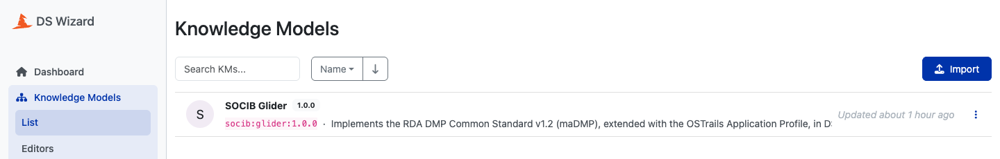
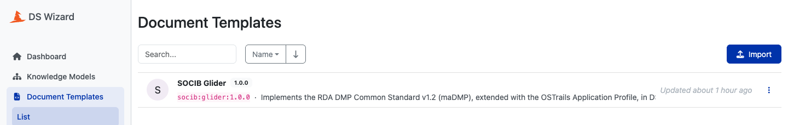
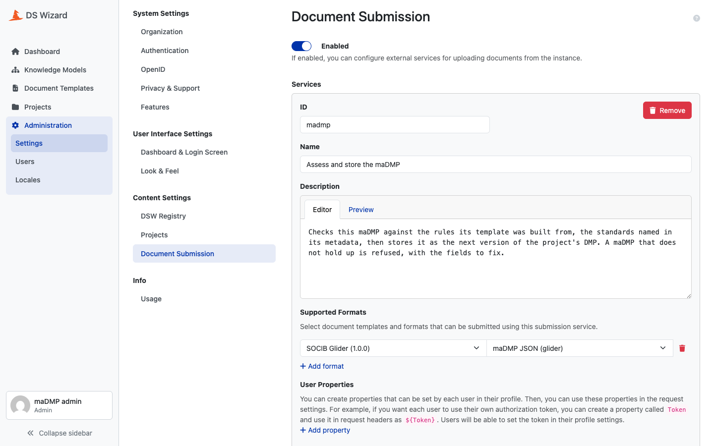
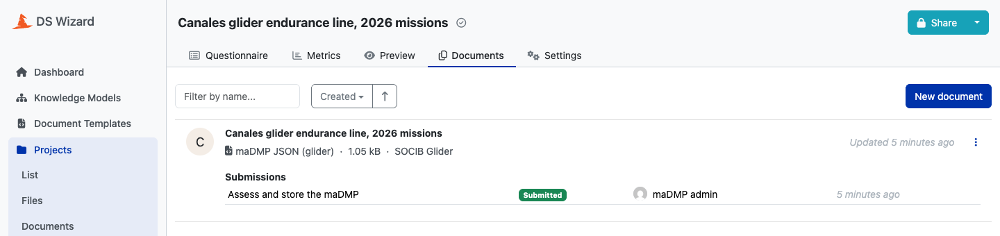

# DS Wizard

[DS Wizard](https://ds-wizard.org) is where a researcher writes the DMP. `madmp dsw` prepares a running instance through its API, in three steps that are safe to run again: the second run changes nothing.

```bash
make dsw-sync ENV_FILE=<file>    # dsw-admin, then dsw-publish, then dsw-submission
```

| Value | |
|---|---|
| `DSW_API_URL` | the instance's API, `…/wizard-api`, as madmp and the browser reach it |
| `DSW_USER`, `DSW_PASSWORD` | the administrator madmp logs in as |
| `SUBMISSION_URL` | where DS Wizard sends a submitted document, as DS Wizard reaches it: the API's `/templates` |
| `TEMPLATE_WRITE_TOKEN` | the token DS Wizard sends with it |

The DS Wizard client is the standard library alone: no dependency for a container to audit.

## 1. The administrator

`make dsw-admin` makes sure `DSW_USER` is an administrator of the instance.

```text
ok   Administrator madmp-admin@example.com created.
ok   Demo accounts deleted: albert.einstein@example.com, nikola.tesla@example.com, isaac.newton@example.com.
```

A new instance opens with three demo accounts whose password is published. When `DSW_USER` cannot log in and the demo administrator still can, `DSW_USER` is created through it. Then every demo account the published password still opens is deleted, as `DSW_USER`, except `DSW_USER` itself; an account whose password was changed is left alone. The order matters: deleting the demo administrator before your own works locks you out of your instance.

## 2. The packages

`make dsw-publish` builds every project version's Knowledge Model and document template in memory, oldest first, and uploads what the instance does not hold.

```text
ok   glider 1.0.0 : KM published: socib:glider:1.0.0
ok   glider 1.0.0 : Template published: SOCIB Glider (de60d7a9-702d-4e18-a7da-c315723a0c49)

packages: 1 project version published.
```





*Both packages carry the identifier `socib:glider:1.0.0` and the description generated from the rules they implement.*

A DS Wizard package is an identity and a version, immutable. A package the instance already holds at that version is read back and compared with the one built, both without their `createdAt` time stamps, which the instance sets again at upload:

- the same content: skipped, `already published`
- another content: **refused**, nothing of that project version uploaded

A changed package under an unchanged version is therefore impossible: it would be a different questionnaire under the same name, and the database would judge its documents by the wrong rules. Raise the project's version instead. `PROJECT=definitions/projects/<id>` limits publication to one project.

## 3. The submission service

`make dsw-submission` creates, or refreshes, the instance's submission service **madmp**: what a researcher picks after clicking **Submit** on a document.

```text
ok   Submission service 'madmp' -> http://dmp-api:8081/templates (templates socib:glider:1.0.0).
```

| Part of the service | Set to |
|---|---|
| name, description | ours, written over |
| request | `POST` to `SUBMISSION_URL`, header `Authorization: Bearer <TEMPLATE_WRITE_TOKEN>`, not multipart |
| supported formats | the **maDMP JSON** format of every template of the repository the instance holds, added to those it supports already |



*The service as `make dsw-submission` writes it, under Administration › Settings › Document Submission.*

A format added by hand in the console, or one of a template the repository no longer has, is kept. DS Wizard has no endpoint for one service: writing it sends back the tenant's **whole** configuration, so madmp reads the configuration first, compares the service over what a write carries, and writes only when they differ. A colleague's change made in the console between two runs is not reverted.

## What the researcher sees

1. A project created on the **SOCIB Glider** Knowledge Model: nine chapters, the questions tagged `REQUIRED`, `OPTIONAL`, `CONTROLLED VOCABULARY` and by standard, and the **Required fields** phase to see what is missing.
2. A document created with the **SOCIB Glider** template, format **maDMP JSON (glider)**, rendered by the document worker into the instance's storage, downloadable from the browser.
3. **Submit**, service **madmp**: DS Wizard posts the document to the DMP API, which answers 201 and the stored version, or 422 and every check to fix.



*A rendered document and its submission: **Submitted** once the API has stored it.*

## Pitfalls we hit

None of these is documented as a trap, and each cost at least an afternoon.

- **The order of the events is the order of the questions.** There is no ordering field. Emit a parent after its child and the child disappears without an error.
- **A bundle outside the metamodel schema publishes fine.** The server ignores unknown keys, so a package nobody else can validate is accepted.
- **A vocabulary label ends up as source code** inside a generated template. An apostrophe in it stops the body being valid Jinja, at render time, in front of a researcher.
- **The package listing returns only the latest version** per identifier; earlier versions are found in its record.
- **There is no endpoint for one submission service.** Writing one sends the tenant's whole configuration back.
- **The submission service's URL must carry its route.** Without the path it posts to the root, and Submit answers 404.
- **Enter through `/wizard`, not the bare origin.** The client redirects `/` to an absolute `http://` address, which behind a TLS terminator is a host that serves only HTTPS.
- **The demo accounts have published credentials**, and deleting them before your own administrator works locks you out of your instance.
- **`S3_URL` must resolve the same from a container and from a browser**: the server writes documents there, the browser downloads them from the links it is given.
- **An ingress that rewrites uploads can break the object storage.** Behind some ingress controllers, the server's uploads to an S3 server published through the same ingress are refused; an S3 server reached directly avoids it.
