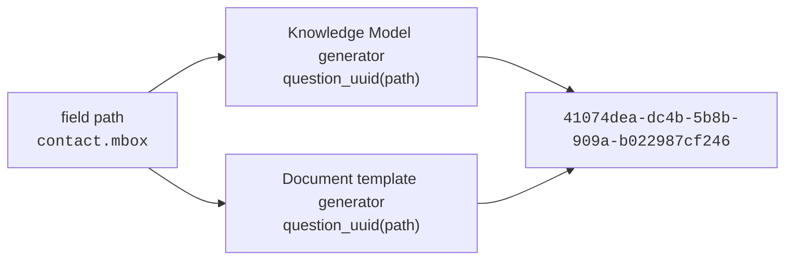

# Identifiers

Every DS Wizard entity generated from the rules takes its identity from the **path of the field it was generated for**. Not from a counter, a lookup table or `uuid4()`. `madmp.packages.uuids` is the whole of it, and it knows nothing but the standard library and the shape of a field path.

```python
NAMESPACE = uuid.UUID("00000000-0000-0000-0000-000000000000")


def u(*parts: str) -> str:
    """Derive a deterministic entity UUID from a sequence of name parts."""
    return str(uuid.uuid5(NAMESPACE, "::".join(parts)))
```

## The derivations

| Entity | Derivation |
|---|---|
| a chapter | `u("chapter", key)` |
| a question | `u(*path, "question")` |
| one answer of an options question | `u(*path, "answer", value)` |
| the generated **Other** answer | `u(*path, "answer", "other")` |
| its free-text follow-up | `u(*path, "other-followup", "question")` |
| the item question of a repeated scalar | `u(*path, "item-value", "question")` |
| the Yes/No gate of a `0..1` object | `u(*path, "has-question")` |
| its Yes and No answers | `u(*path, "has-answer", "yes")`, `u(*path, "has-answer", "no")` |

What no field produces takes its identity from a fixed name: the root `u("root")`, the phase `u("phase", "required")`, a tag `u("tag", name)` or `u("tag", "origin", standard)`, the event that adds an entity `u(entity, "event")`, a template's format `u("template", "format", name)` and its file `u("template", "file", package_id, file_name)`, new at each version.

The generated **Other** is by construction the answer of the value `"other"`, which is why a vocabulary that already lists that word gets no second one: the two would be the same entity.

## What it buys



**Two generators agree without talking.** The Knowledge Model and the document template both need the UUID of the question for `dmp.contact.mbox`. Neither passes it to the other, neither reads a table: both call `question_uuid(("contact", "mbox"))` and get the same answer. A template therefore cannot reference a question its Knowledge Model does not contain.

**Publishing is idempotent.** Regenerating a package gives the same identities, which is what lets `madmp dsw publish` compare a package with the one an instance holds.

**A project survives a rules change.** Answers are stored against question UUIDs, and a question keeps its identity as long as its field keeps its path, so adding a field elsewhere orphans no existing answer.

## Checking it

```python
from madmp.packages.uuids import question_uuid

question_uuid(("contact", "mbox"))
# '41074dea-dc4b-5b8b-909a-b022987cf246'
```

| Field path | Question UUID |
|---|---|
| `title` | `a378983e-92e8-5e65-81c0-a0b50727b377` |
| `language` | `7b0592f8-156f-5de5-b099-173d39e74928` |
| `contact.mbox` | `41074dea-dc4b-5b8b-909a-b022987cf246` |
| `contact.contact_id` | `34c28ed2-b193-5502-bb9c-2aa158ff5a5a` |
| `dataset.dataset_id.identifier` | `dc3b0a11-3e69-5fbc-9167-b417e4bbf629` |
| `dataset.personal_data` | `8eb6c4d3-89de-52c8-b0ad-0d3d841f594e` |

These are the UUIDs of the published `socib:glider:1.0.0`, and what a reply path in DS Wizard is built from: `<chapter>.<question>`, or `<chapter>.<list question>.<item>.<child question>` inside a list.

!!! danger "Frozen"

    The namespace and every literal part string are the identity of every entity in every published Knowledge Model and template. Change one and every derived UUID changes: published packages stop matching and every stored answer is orphaned. The tests hold derived values of every kind of entity, so a change fails at once rather than at publication. Do not "fix" those expectations.

## Why a nil namespace

`uuid5` needs a namespace, and the usual ones (`NAMESPACE_URL`, `NAMESPACE_DNS`) would claim these identifiers are URLs or domain names. The nil UUID claims nothing. What prevents collisions is the part strings, unique per kind of entity by construction, and a test that one path gives every kind a distinct identity.
