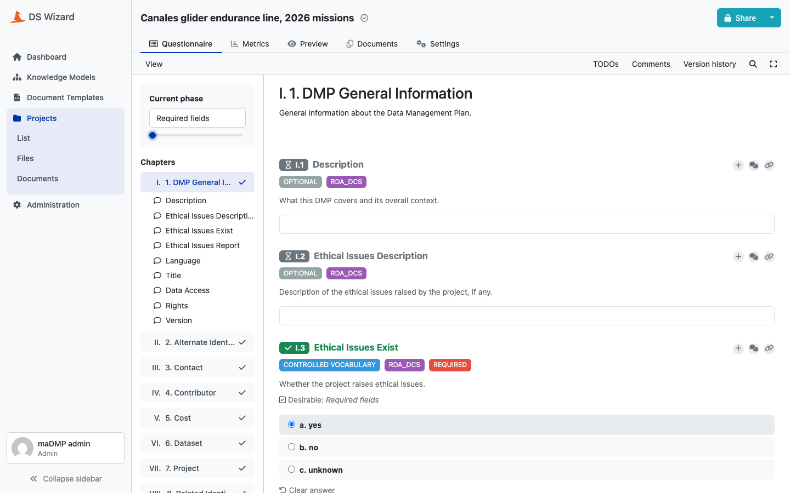
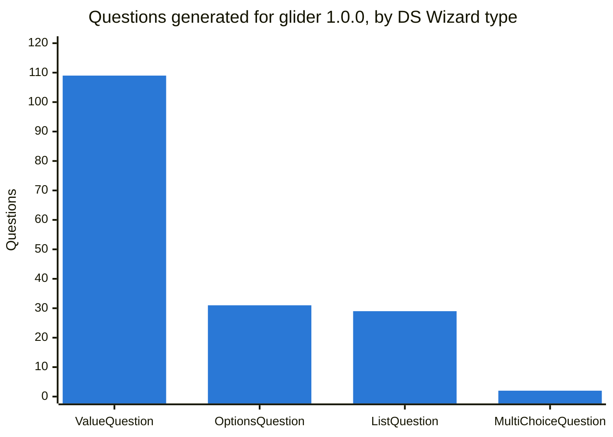
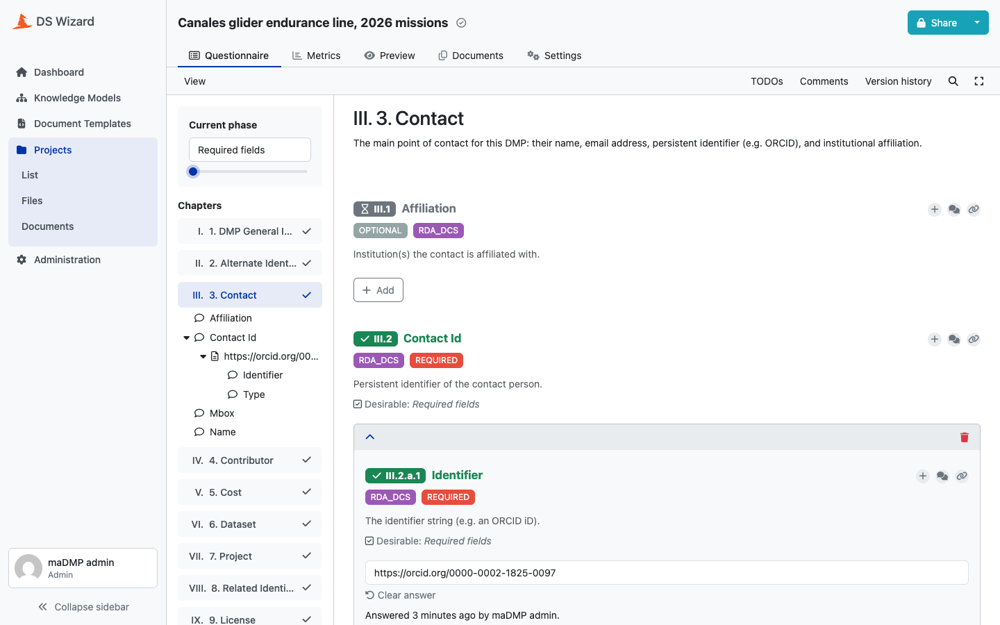
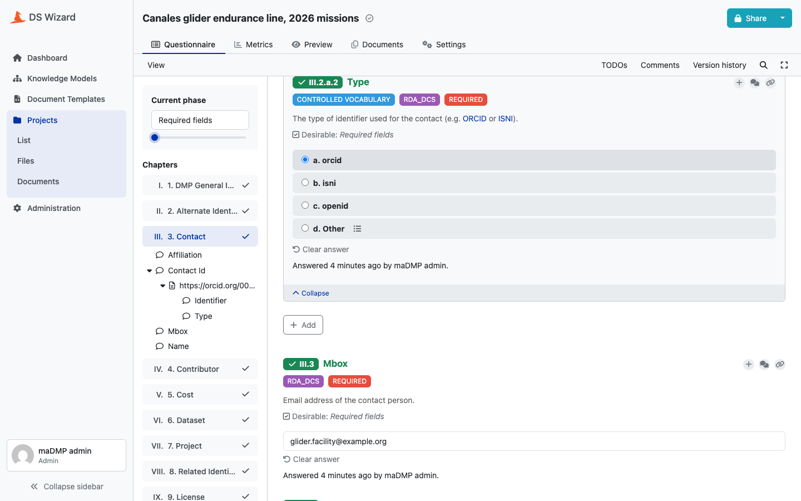

# Knowledge model

`madmp.packages.km` walks the merged model and emits a DS Wizard Knowledge Model bundle: the questionnaire, as a list of events.

```bash
make packages-generate OUT=dsw-packages    # dsw-packages/glider_1.0.0_km.km
```

## A bundle is a list of events

DS Wizard does not take a description of a questionnaire, it takes the events that would have built one. For `socib:glider:1.0.0`, **492 events**:

| Event | Count |
|---|---|
| `AddKnowledgeModelEvent` | 1 |
| `AddPhaseEvent` | 1 |
| `AddTagEvent` | 5 |
| `AddChapterEvent` | 9 |
| `AddQuestionEvent` | 171 |
| `AddAnswerEvent` | 265 |
| `AddChoiceEvent` | 40 |

Each carries its `entityUuid` and the `parentUuid` it hangs from, both derived by the [identifier convention](identifiers.md).

!!! warning "Emission order is reading order"

    DS Wizard infers the order of siblings from the order of the events. There is no order field: the order questions are emitted in is the order a researcher reads them, and it is the order the rules file declares its fields in. A data steward reorganising a questionnaire reorders a JSON file. One invariant must hold for any project, and a test holds it: no event references a parent not yet emitted, otherwise the child disappears without an error.

## The metamodel version is pinned

```python
METAMODEL_VERSION = 20
```

It describes the **instance**, not the project: the Knowledge Model metamodel is version 20 in DS Wizard 4.31, and `kmp_schema_v20.json` in [dsw-schemas](https://github.com/ds-wizard/dsw-schemas) is what an event must look like. Each of those schemas is `additionalProperties: false`, so **a field the schema does not define is not a field this generator sends**. A test checks every event against the fields its metamodel defines. DS Wizard's server ignores unknown keys, so a bundle outside the schema would publish fine and be a bundle nobody else can validate.

## Chapters: a split, not a filter

A top-level field becomes a chapter of its own exactly when it is an object, single or list. Every top-level scalar joins one shared general chapter. Nothing is dropped: every declared field is asked, because the rules **are** the questionnaire.



*The general chapter of a glider project: `ethical_issues_exist` is a closed vocabulary, required by `RDA_DCS`; the chapters on the left are the top-level fields.*

| # | Chapter | From |
|---|---|---|
| 1 | DMP General Information | `title`, `description`, `language`, `ethical_issues_*`, `version`, … |
| 2 | Alternate Identifier | `alternate_identifier` |
| 3 | Contact | `contact` |
| 4 | Contributor | `contributor` |
| 5 | Cost | `cost` |
| 6 | Dataset | `dataset` |
| 7 | Project | `project` |
| 8 | Related Identifier | `related_identifier` |
| 9 | License | `license`, from the OSTrails profile |

Three top-level fields are **computed** and get no question: `created` and `modified` come from the DS Wizard project's own dates, and `dmp_id` from its address, filled by the [document template](document-template.md).

## What a field becomes

`field_kind()` decides, and it is the only place that decides. The two generators dispatch on its answer and refuse a kind they do not know.

```python
if len(field.path) == 1 and field.name in computed_fields:
    return "computed"
if field.type == "object":
    if field.is_list:
        return "list"
    return "object_gated" if field.cardinality == "0..1" else "object_inline"
multi = field.is_list
if field.allowed_values is not None:
    return "options_strict_multi" if multi else "options_strict"
if field.suggested_values is not None:
    return "options_suggested_multi" if multi else "options_suggested"
if field.type == "boolean":
    return "boolean"
return "value_multi" if multi else "value"
```

| Kind | Rules field | DS Wizard entity | Glider |
|---|---|---|---|
| `computed` | a top-level field the template fills | no question | 3 |
| `list` | object, `1..n` or `0..n` | `ListQuestion` with an item template | 25 |
| `object_gated` | object, `0..1` | Yes/No `OptionsQuestion`, children under Yes | 3 |
| `object_inline` | object, `1` | its children, inline | 6 |
| `options_strict` | scalar with `_allowed_values` | `OptionsQuestion`, no escape | 8 |
| `options_suggested` | scalar with `_suggested_values` | `OptionsQuestion` plus **Other** and a free-text follow-up | 20 |
| `options_strict_multi`, `options_suggested_multi` | the same, `..n` | `MultiChoiceQuestion` | 1 + 1 |
| `boolean` | `_type: boolean` | `OptionsQuestion`, Yes/No | 1 |
| `value` | any other scalar | `ValueQuestion`, typed | 91 |
| `value_multi` | the same, `..n` | `ListQuestion` over one `ValueQuestion` | 4 |



**`object_gated`.** DS Wizard has no way to say "this whole block is optional", so a `0..1` object is put behind a Yes/No gate and its questions hang from the Yes answer.



*`dmp.contact.contact_id` is a list of objects, so it became a list question; its children are the questions inside each item, and the tree on the left mirrors the rules tree.*

**`value_multi`.** A repeated scalar has no DS Wizard equivalent either. It becomes a `ListQuestion` whose item template is one `ValueQuestion`. For the researcher it looks like any other list.

**`options_suggested`.** A recommended vocabulary gets an extra **Other** answer opening a free-text follow-up, unless it already lists `other` itself, in which case that value is its escape and no second one is added.



*`dmp.contact.contact_id[].type` recommends `orcid`, `isni` and `openid`; the generated **Other** opens a free-text follow-up.*

## Scalar types become value types

| Rules `_type` | DS Wizard `valueType` |
|---|---|
| `string`, `currency`, `country_code`, `language` | `StringQuestionValueType` |
| `number` | `NumberQuestionValueType` |
| `date` | `DateQuestionValueType` |
| `datetime` | `DateTimeQuestionValueType` |
| `email` | `EmailQuestionValueType` |
| `url` | `UrlQuestionValueType` |

DS Wizard has no type for a language, a currency or a country code. They are asked as strings with the pattern the assessment uses, so DS Wizard checks them while they are typed, and the [assessment](assessment.md) checks them again at submission.

## Tags and the phase

| Tag | On |
|---|---|
| `REQUIRED` | a field whose cardinality is `1` or `1..n` |
| `OPTIONAL` | every other field |
| `CONTROLLED VOCABULARY` | a field carrying either vocabulary |
| `RDA_DCS`, `OSTRAILS` | the standard that introduced the field |

Standard tags are derived from each rules file's own declaration, so adding a file never means wiring its tag by hand. `REQUIRED` names the standard that actually imposes the constraint, extensions included, from what the merge recorded. One phase, **Required fields**, lets a researcher ask DS Wizard what is still missing: 81 questions for glider.

## Every question carries its rules path

Each question is annotated with the rules field it fills, `rules_path`, so a consumer can relate a reply to the field it populates. **Every** question, including the item template of a repeated scalar: its list's reply is a list of item UUIDs, and the value itself is stored against the item template, so it is the one entity a consumer meets while walking the replies. The general chapter, ours and not a standard's, is the one entity without a path.

## The README of each package

Generated from the project and the rules: name and description, what it is compatible with, the rules versions it was built from, the author, and the references of every standard. DS Wizard shows it on the package's page.
