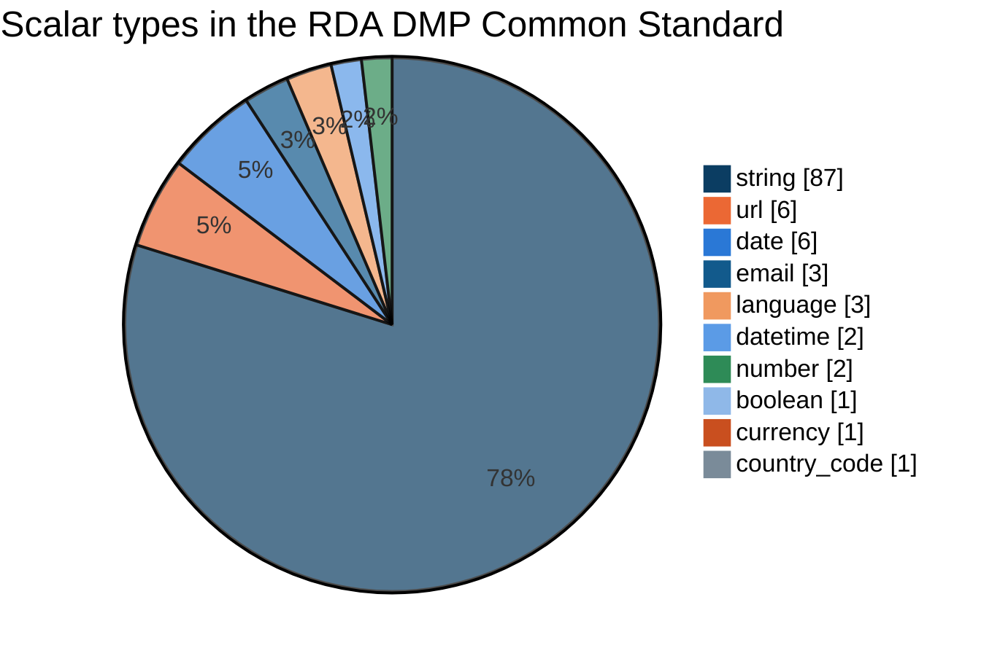

# Rules

A standard at one version is one JSON file, `definitions/rules/<standard>/<version>.json`: a short declaration, then a tree of fields under `dmp`. Every questionnaire, template and check in this project is derived from these files.

## The standards loaded

| Standard | Version | Role | Fields | Top-level | Objects | Required | Closed vocabularies | Recommended vocabularies |
|---|---|---|---|---|---|---|---|---|
| `rda_dcs`, RDA DMP Common Standard v1.2 (maDMP) | 1.0.0 | base | 146 | 16 | 34 | 75 | 8 | 21 |
| `ostrails`, OSTrails Application Profile | 1.0.0 | extends `rda_dcs` 1.0.0 | 21 | 7 | 5 | 3 | 1 | 0 |

The OSTrails profile declares 21 fields: 17 of its own, and 4 parents (`dataset`, `distribution`, `project`, `cost`) redeclared identically to reach them. Merged for the glider project, that is **163 fields**.



## The file

```json
{
  "standard": "ostrails",
  "version": "1.0.0",
  "extends": { "standard": "rda_dcs", "versions": ["1.0.0"] },
  "name": "OSTrails Application Profile",
  "references": [
    {
      "label": "OSTrails Application Profile for maDMPs",
      "url": "https://docs.ostrails.eu/en/latest/commons/dmp/application-profile.html"
    }
  ],
  "description": "Free-form notes about this file's scope and conventions.",
  "dmp": { "...": "the field tree" }
}
```

| Key | Required | What it says |
|---|---|---|
| `standard` | yes | the standard's identifier, snake_case, and the name of its directory |
| `version` | yes | `X.Y.Z`, and the name of the file |
| `extends` | extension only | the base it extends, and every version of it the extension was written for |
| `name` | yes | the standard as a reader sees it, in the packages' README and description |
| `references` | yes | where the standard is documented, one `label` and `url` each |
| `description` | no | notes for the next author |
| `dmp` | yes | the field tree, at least one top-level field |

## A field

A field is an object whose keys starting with `_` describe it and whose other keys are its child fields.

| Key | | Meaning |
|---|---|---|
| `_cardinality` | required | `1` exactly one, `0..1` at most one, `1..n` at least one, `0..n` any number. `n` means a JSON array |
| `_type` | required | `object`, or a scalar: `string`, `number`, `boolean`, `date`, `datetime`, `email`, `url`, `currency`, `country_code`, `language` |
| `_description` | base: required | the question a researcher reads |
| `_chapter_description` | optional | the text a top-level object's chapter opens with |
| `_allowed_values` | optional | a closed vocabulary: any other value fails |
| `_suggested_values` | optional | a recommended vocabulary: any other value is a warning |

Field names are snake_case. Being a list is said by the cardinality alone: there is no `list` type.

```json
"contact": {
  "_cardinality": "1",
  "_type": "object",
  "_chapter_description": "The main point of contact for this DMP: their name, email address, persistent identifier (e.g. ORCID), and institutional affiliation.",
  "_description": "The person responsible for this DMP.",
  "mbox": {
    "_cardinality": "1",
    "_type": "email",
    "_description": "Email address of the contact person."
  }
}
```

*An excerpt of `rda_dcs/1.0.0.json`: `contact` opens a chapter of its own, `mbox` is one of its questions.*

## Three checks when a file loads

Every problem of a step is reported at once, and a step runs only when the one before passed.

1. **Reading.** The file is JSON, readable, and parses.
2. **Schema.** `rules.schema.json`, strict: an unknown key, a wrong type or a missing required key is refused.
3. **Layout and coherence.** The declared `standard` names the directory and the `version` the file, then six coherence rules the schema cannot express:
    - only an `object` field declares child fields,
    - every `object` field declares at least one,
    - a vocabulary sits only on a scalar field,
    - never both vocabularies on one field,
    - `_chapter_description` only on a top-level object,
    - in the base standard, every field has a `_description`.

    And an extension extends another standard than its own.

```bash
make validate-rules
```

## Standards and profiles

A project pins one base standard and any number of extensions, and the [model](../reference/model.md) merges them, base first. An extension may only **tighten** what the base defines.

| On a field the base defines, an extension may | Example |
|---|---|
| redeclare it identically | `dataset`, to reach its own new child fields |
| make it required | `0..1` → `1`, `0..n` → `1..n` |
| narrow a closed vocabulary to a subset | `yes, no, unknown` → `yes, no` |
| close an open field with a vocabulary of its own | free text → a list |
| close a recommended vocabulary over the values it recommends | suggested → allowed |
| give a top-level object the chapter description the base left out | |

| An extension may **not** | Why |
|---|---|
| loosen a cardinality | a DMP valid under the profile would be invalid under the base |
| turn a single value into a list, or back | the shape of the JSON would change |
| change a type | the same value would be judged two ways |
| widen a vocabulary, or offer a closed one back as recommended | the base's promise would no longer hold |
| describe a field the base described, in other words | two texts would compete for one question |

Each extension is judged against the **base**, never against what another extension imposed, and what several extensions require combines: the strictest cardinality, the intersection of the vocabularies. So the merged model does not depend on the order the pins are written in. Every conflict across every file is reported in one error, naming the standards involved.

Every tightening is recorded on the field with the standard that imposed it, and a check failing on that constraint says so, for example *(required by ostrails)*.

!!! info "Honest scope"

    On the standards loaded, the merge performs no tightening: the OSTrails profile only adds fields. The tighten-only machinery is exercised by the tests on fixtures, and becomes load-bearing with the first profile that constrains a field the base defines.

## Versions are frozen

A published rules file never changes: a change is a new version, in a new file. `make validate-frozen` compares the checkout with the point it left `origin/main` and names every version file that point has and the checkout changed or removed; the CI runs it on every pull request and push. A project pins the new version when it is ready, by a new project version.

## Adding a standard or a version

1. Copy the closest file to `definitions/rules/<standard>/<version>.json`.
2. Edit the fields, keeping the declared `standard` and `version` equal to the path.
3. `make validate-rules`, then pin it from a new [project version](projects.md) and `make validate-models`.
