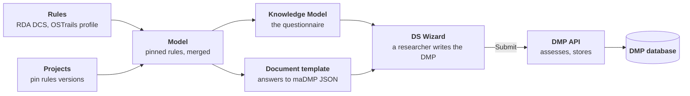

# Rules-driven maDMPs

> A rule added to a JSON file becomes a DS Wizard question **and** a check of every DMP submitted, with no code and no room for drift.

Machine-actionable Data Management Plans built at SOCIB as the ENVRI/JERICO thematic pilot of OSTrails. One declarative rule set, the RDA DMP Common Standard with the OSTrails Application Profile on top of it, generates the Data Stewardship Wizard questionnaire, the document template that turns answers into a maDMP, and the assessment every maDMP faces before it is stored, version by version, behind an API.

[Get started](getting-started.md){ .md-button .md-button--primary } [Read the case](case/context.md){ .md-button } [Source code](https://github.com/pstcricq/ostrails-madmp){ .md-button }

This site is both the case study SOCIB contributed to OSTrails deliverable **D4.3, Case Studies and Proof of Concept Instances** (see [D4.3](project/d4-3.md)), and the technical guide of the `madmp` repository that implements it. To install and run the project quickly, the [README](https://github.com/pstcricq/ostrails-madmp#readme) is the shorter path.

**Status: tested end to end, deployed by CD.** A researcher fills in the generated questionnaire, clicks Submit, and the maDMP is assessed against the rules it names and stored as the next version of its project's DMP. The chain runs on a laptop under Docker Compose, on a local Kubernetes cluster, and on a remote Kubernetes cluster deployed by the GitLab CD. It has not yet carried a real project of a research group in production.

## By the numbers

Measured on the glider project 1.0.0, DS Wizard 4.31.

-   :material-file-tree-outline:{ .lg .sea } __Rules loaded__

    146 + 21 fields

    The RDA DMP Common Standard as the base, the OSTrails profile adding 17 fields of its own.

-   :material-form-select:{ .lg .sea } __Generated questionnaire__

    171 questions

    492 events in 9 chapters, 81 of the questions required.

-   :material-code-json:{ .lg .sea } __Generated template__

    83 950 characters

    Of Jinja that renders the answers into a maDMP JSON document.

-   :material-check-decagram-outline:{ .lg .act } __Assessment__

    every write

    Presence, shape, type, vocabularies and unexpected keys, each message naming the standard that imposes it.

-   :material-database-lock-outline:{ .lg .act } __DMP database__

    never overwritten

    Every version kept with its assessment and the project version it came from; PostgreSQL refuses an update.

-   :material-test-tube:{ .lg .ok } __Tests__

    601

    506 unit tests, 95 integration tests against a real PostgreSQL, the API and the image.

## How it fits together

Everything on the left is data in the repository, every arrow is a `madmp` command, and the two generated packages agree because they are derived from the same field paths. See [Architecture](guide/architecture.md).

## Where to go next

-   :material-lightbulb-on-outline:{ .lg .act } __Why this exists__

    The problem three hand-built artifacts create, and the principle that removes it.

    [:octicons-arrow-right-24: The problem](case/problem.md)

-   :material-rocket-launch-outline:{ .lg .act } __Run it__

    Install, validate the definitions, build the packages, start the stack.

    [:octicons-arrow-right-24: Getting started](getting-started.md)

-   :material-book-open-variant:{ .lg .sea } __Understand a part__

    Rules, projects, the assessment, the two packages, the database, the API, DS Wizard.

    [:octicons-arrow-right-24: Guide](guide/architecture.md)

-   :material-kubernetes:{ .lg .sea } __Deploy it__

    The values, Docker Compose, Kubernetes, and the CI and CD on GitHub and GitLab.

    [:octicons-arrow-right-24: Deployment](deployment/index.md)

## Author

-   :material-account-outline:{ .lg .sea } __Pierre St-Cricq dit Lompre__

    Designed and developed the rules, the generators, the assessment, the DMP API and their deployment, at SOCIB, for the ENVRI/JERICO thematic pilot of OSTrails.

    [:fontawesome-brands-github: pstcricq](https://github.com/pstcricq) · [:material-email-outline: pstcricq@socib.es](mailto:pstcricq@socib.es)

-   :material-domain:{ .lg .sea } __SOCIB__

    Balearic Islands Coastal Observing and Forecasting System, Palma. With Miguel Charcos Llorens and Oana Dragomir.

    [:material-web: www.socib.es](https://www.socib.es) · [:material-earth: ostrails.eu](https://ostrails.eu)

---

OSTrails is funded by the European Union under HORIZON-INFRA-2023-EOSC-01, grant agreement 101130187. Views and opinions expressed are those of the authors only and do not necessarily reflect those of the European Union or the European Research Executive Agency.
